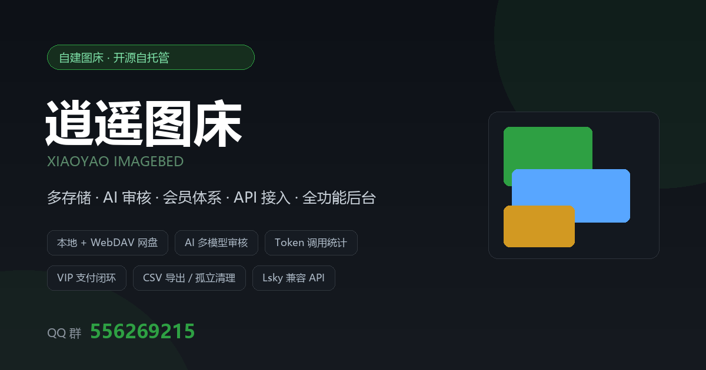
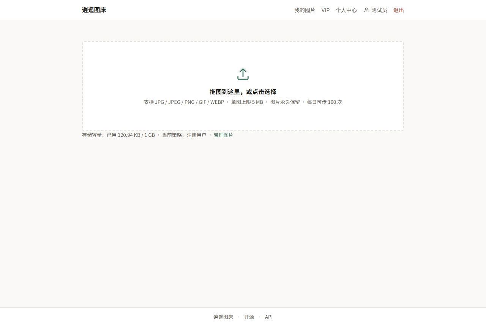
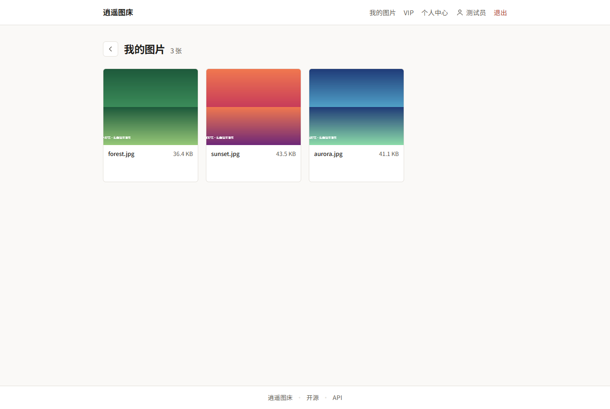
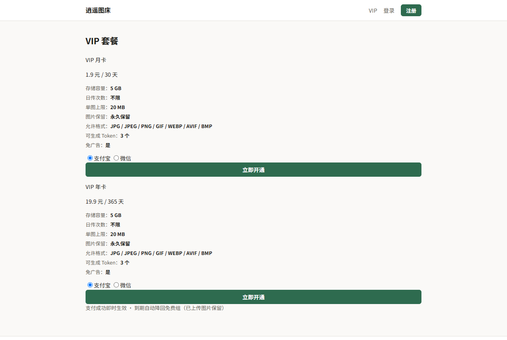
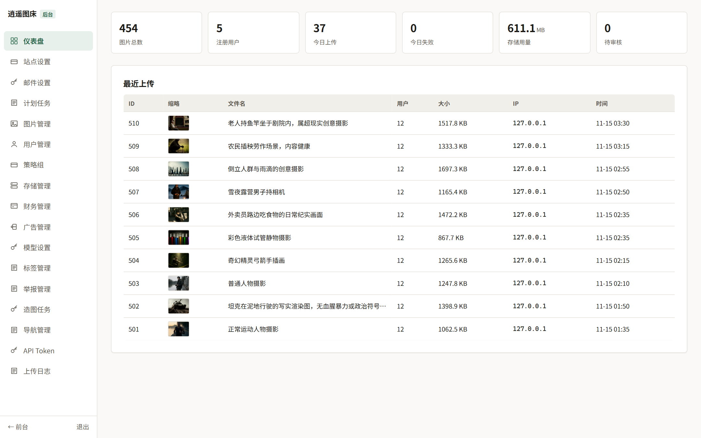
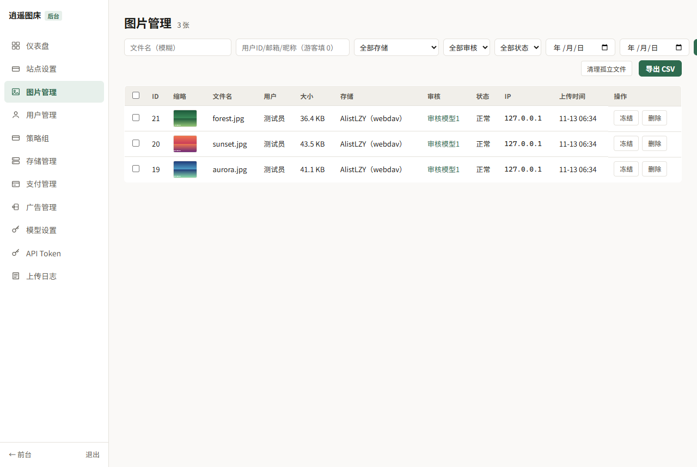

<div align="center">



# XiaoYao ImageBed · 逍遥图床

**自托管图床：上传即得稳定外链，多存储驱动、多模型 AI 审核、会员与支付闭环**

PHP 8.2 · ThinkPHP 8.1 · MIT License

[功能](#功能全景) · [截图](#界面预览) · [部署](#快速开始) · [API](docs/API.md) · [路线图](#路线图) · [交流](#交流)

</div>

---

## 功能全景

### 上传与外链
- [x] 拖拽 / 点选 / 粘贴上传，悬浮进度条（上传 + 服务端处理两阶段提示）
- [x] **SHA1 秒传**：同文件自动复用记录，不重复占用存储
- [x] 四格式输出：URL / Markdown / HTML / BBCode，一键复制
- [x] 外链双模式：**代理中转**（防盗链有效）/ **302 直链**（零服务器流量），按存储实例配置
- [x] 前台实时展示当前策略组权益（格式 / 单图上限 / 保留天数 / 日次数）

### 用户与策略组
- [x] 注册 / 登录 / 退出（bcrypt），注册默认组、游客组可配
- [x] **策略组体系**：单图上限、日上传次数、存储容量、图片保留天数、允许扩展名、免广告、**可生成 Token 数量（-1 禁止 / 0 不限 / N 上限）**
- [x] 策略组支持启用/停用/删除；系统三组保护
- [x] 个人中心权益面板（与后台策略组实时同步）

### 存储
- [x] 多实例并存：**本地磁盘 / WebDAV**（坚果云、Alist 聚合网盘），按策略组分配
- [x] 存储卡片：磁盘剩余/网盘空间、**配额阈值（达量停止上传）**、图床已用统计
- [x] **孤立文件清理**：扫描存储目录 vs 数据库引用，本地与网盘一并清理（1 小时新文件保护）
- [x] 删除图片同步删除存储文件（本地 unlink / 网盘 DELETE）

### AI 内容审核
- [x] **多模型链**：模型卡片可增删、上下移排序、单独启停、失败自动切换
- [x] **两种协同模式**：顺序切换（失败换下一个）/ 并行投票（同时审核取多数）
- [x] 卡片管理：失败计数、最近成功时间、**一键测试连接**（真实请求验证）
- [x] **双体系**：审核模型（后台管理用）/ 生成模型（前台文生图，走 `/images/generations`）
- [x] 审核结论可见：图片列表直接显示**判定模型名**，悬停查看具体理由
- [x] 全部模型失效 → 转人工复审（不冻结外链，后台可复核）

### 运营与变现
- [x] **易支付双网关**：逍遥PAY（`/submit.php`）+ 标准易支付（`/api/submit.php`）
- [x] **多通道**：支付宝 / 微信 / QQ 钱包独立配置，前台按后台开关展示
- [x] VIP 套餐：权益**自动同步策略组**（容量/日传/单图/保留/格式/Token 数），描述留空不显示
- [x] 支付回调闭环：验签 → 订单更新 → VIP 自动生效 → 到期自动回组
- [x] 广告位系统（HTML/图片/JS，四位置，免广告组不显示）
- [x] 三种运营模式：纯免费+广告 / 免费+付费双层 / 邀请制纯付费

### 开放 API
- [x] **Lsky Pro 兼容**：`/api/v1/upload | info | list | delete`
- [x] Token 鉴权三方式：`X-API-TOKEN` / `Authorization: Bearer` / `?token=`
- [x] Token 调用统计：总调用、上传成功/失败、列表/信息/删除分列；周期统计卡片（今日/7日/累计）
- [x] 完整文档：[docs/API.md](docs/API.md)（含 PicGo / Typora 配置）

### 后台（11 模块）
- [x] 仪表盘（图片/用户/上传/失败/存储/待审统计 + 最近上传）
- [x] 图片管理：存储/用户/审核/状态/日期筛选、批量冻结/解冻/删除、**CSV 导出**、孤立文件清理
- [x] 用户管理：ID/邮箱/昵称搜索、策略组/状态/日期筛选、行内编辑、批量启用/禁用/改组
- [x] 策略组 / 存储管理 / 支付管理 / 广告管理 / **模型设置** / **API Token** / 上传日志（筛选+批量+按天清理）
- [x] 站点设置（独立菜单）：站点名 / 运营模式 / 注册开关 / 游客与注册组

## 界面预览

| 前台上传 | 我的图库 |
|:---:|:---:|
|  |  |

| VIP 套餐 | 后台仪表盘 |
|:---:|:---:|
|  |  |

| 图片管理（多存储 · 模型名审计） | |
|:---:|:---:|
|  | |

## 快速开始

```bash
git clone https://github.com/cd1005-art/imgbed.git
cd imgbed
composer install --no-dev
mysql < install.sql        # 建库 + 全部表 + 初始数据
cp .env.example .env       # 改数据库连接
```

### 环境要求

| 项 | 要求 |
|---|---|
| PHP | >= 8.1（推荐 8.2），扩展：fileinfo / gd / mbstring / curl |
| MySQL | 5.7+ / 8.0 |
| Web | Nginx（Apache 亦可） |

### Nginx 伪静态（TP8 必须）

```nginx
location / {
    if (!-e $request_filename) {
        rewrite ^(.*)$ /index.php/$1 last;
    }
}
# 外链路由优先级（图片扩展名会被静态正则拦截）
location ^~ /i/ {
    if (!-e $request_filename) {
        rewrite ^ /index.php$request_uri last;
    }
}
```

> 详细部署步骤（含宝塔 / Docker / 排障）见 [docs/DEPLOY.md](docs/DEPLOY.md)；开发踩坑记录见 [docs/PITFALLS.md](docs/PITFALLS.md)。

## 路线图

> 说明：以下为功能规划方向，随版本逐步推进；具体版本以仓库 Release / Commit 为准。

### 近期（体验完善）
- [ ] **邮箱通知体系（P0）**：SMTP 配置 + 测试发送、注册验证（lazy）、找回密码、存储告急告警
- [ ] **AI 标签**：审核同时生成 1~N 个标签（数量可配）、自生长词表 + AI 同义归并、后台标签筛选
- [ ] 前台多文件队列上传 + 失败重试 + 拖拽排序
- [ ] 图片详情页；图库按时间/大小/存储筛选
- [ ] 图片处理：水印、压缩、WebP 自动转换、缩略图、EXIF 清理
- [ ] 用户中心：Token 页面权限细化、「我的权益」独立页
- [ ] 暗色/亮色主题切换

### 中期（内容生态与商业化）
- [ ] **图片详情页 + 公开体系**：单张/批量/全部/自动公开、匿名、管理员下架（不可再上架）
- [ ] **图片广场 /explore + 标签聚合页 /tag/{name}**（SEO 落地页）
- [ ] **举报体系**：AI 二次审核（成立自动下架，可配仅下架/下架+冻结外链）、按策略组限制举报权限
- [ ] **违规指纹库**：SHA1 + pHash 前置匹配防马甲重传，违规 N 次自动停用账号
- [ ] **付费解锁与分成**：站币、单图解锁/VIP 月卡/商用授权、AI 与自制分成比例可分设
- [ ] **提现体系**：绑定支付宝、申请提现、后台审核打款、收益流水

### 中期（存储与审核增强）
- [ ] **S3 协议驱动**（OSS / COS / R2），与本地/WebDAV 并列
- [ ] **存储负载均衡**：按策略组 + 剩余空间/配额自动选实例
- [ ] 存储迁移工具（实例间搬迁图片）
- [ ] 策略组级审核覆盖（组内独立模型链）
- [ ] 人工复审队列页面（批量通过/拒绝）+ 违规样本库
- [ ] 备份/恢复：数据库与图片增量备份脚本

### 中期（AI 文生图）
- [ ] 前台文生图页面（使用「生成模型」卡片，`/images/generations`）
- [ ] 生成历史与配额（与策略组联动）
- [ ] 生成结果一键入图床
- [ ] **造图机器人**：后台定时定量生成 → 自动走审核/标签/公开，作为文生图验收通道

### 远期（平台化）
- [ ] 多管理员 + RBAC 权限
- [ ] 公告系统 / 邮件通知
- [ ] 广告排期与点击/曝光统计
- [ ] 统计报表（日/周/月，导出）
- [ ] i18n 多语言（中/英）
- [ ] Docker 镜像 + 一键部署脚本（已提供 Dockerfile 基础）
- [ ] 防盗链增强：Referer 白名单、Token IP 白名单与有效期

## 交流

- **QQ 群：556269215** —— 使用答疑、功能建议、部署支持
- Issue：https://github.com/cd1005-art/imgbed/issues
- License：[MIT](LICENSE)
